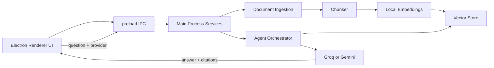

# Electron + RAG Capstone (Guided Learning)

## Approach

You will build this **one milestone at a time**. For each milestone I will give you: files to create, code to write, how to run it, and how to verify it. You implement; when you hit errors, paste them here and we debug together. Do **not** jump ahead until the current milestone works.

**Defaults chosen for learning + your stack:**
- **Desktop shell:** Electron (main + preload + renderer)
- **UI:** plain HTML/CSS/JS (no React yet — fewer moving parts while learning Electron)
- **LLMs:** Groq and Gemini behind one provider interface; UI dropdown to switch
- **Embeddings:** local via `@xenova/transformers` (Groq has no embeddings API; this keeps RAG working the same regardless of which chat LLM you pick)
- **Vector store:** file-based LanceDB (or a simple JSON + cosine store if LanceDB install is painful on Windows — we pick based on Milestone 5)
- **Agents:** small custom pipeline (Planner → Retriever → Reasoner → Validator), not a heavy framework — easier to debug

## Architecture



## Target folder structure

```
playElectronApp/
  package.json
  .env                 # GROQ_API_KEY, GEMINI_API_KEY (never commit)
  .env.example
  electron/
    main.js            # window + IPC handlers
    preload.js         # safe bridge to renderer
  renderer/
    index.html
    styles.css
    app.js
  src/
    config.js          # provider selection, paths
    providers/
      llm.js           # createLLM(providerName)
      groq.js
      gemini.js
    ingestion/
      loadDocument.js  # PDF / TXT / CSV / Excel
      chunkText.js
    rag/
      embed.js
      vectorStore.js
      retrieve.js
    agents/
      planner.js
      reasoner.js
      validator.js
      orchestrator.js
  data/
    uploads/           # saved files
    vectors/           # vector DB files
```

## Prerequisites (do once before Milestone 1)

1. Create free API keys:
   - [Groq Console](https://console.groq.com/) → API key
   - [Google AI Studio](https://aistudio.google.com/) → Gemini API key
2. Keep Node **v24** (already installed). Prefer `npm` for this project.
3. Create `.env` only after we scaffold `.env.example` (never paste keys into chat).

---

## Milestone map (maps to your 6 learner tasks)

### Milestone 1 — Project foundation (Task 1)
**Goal:** Electron app opens a window and loads a blank UI; env config loads.

**You will:**
- `npm init`, install `electron`, `dotenv`
- Create `electron/main.js`, `electron/preload.js`, `renderer/index.html`
- Add npm scripts: `"start": "electron ."`
- Load `.env` in main process

**Verify:** `npm start` opens a window with title like “Enterprise Doc QA”. DevTools open via `Ctrl+Shift+I`.

**Common debug:** blank window → wrong `loadFile` path; app quits immediately → check main process console errors.

---

### Milestone 2 — User interaction layer (Task 2)
**Goal:** UI to upload a file, type a question, pick **Groq / Gemini**, click Ask; IPC round-trip works (even if answer is a stub).

**You will:**
- Build simple UI: provider `<select>`, file input, question box, Ask button, answer panel
- Expose IPC APIs via `preload`: `uploadDocument`, `askQuestion`, `getProvider`
- Main handlers return stub responses first (`"IPC OK: received question…"`)

**Verify:** Choose provider, click Ask without a real LLM — see stub text in the UI.

**Common debug:** `require is not defined` in renderer → must use preload + `contextIsolation: true`; IPC never fires → channel name mismatch.

---

### Milestone 3 — Document ingestion (Task 3)
**Goal:** Upload PDF, TXT, CSV, Excel; extract plain text; save under `data/uploads/`.

**You will:**
- Install parsers: `pdf-parse`, `mammoth` optional later, `csv-parse` / `xlsx` for CSV/Excel
- `loadDocument(filePath)` → `{ text, meta }`
- Show extracted character count / preview in UI

**Verify:** Upload a small `.txt` and a `.pdf`; UI shows text length > 0 for both.

**Common debug:** PDF empty text → scanned image PDF (OCR out of scope); Excel garbled → wrong sheet; path with spaces on Windows → use `path.normalize` and quotes carefully.

---

### Milestone 4 — Chunking for semantic search (Task 4)
**Goal:** Split extracted text into overlapping chunks with stable IDs and metadata (source file, chunk index).

**You will:**
- `chunkText(text, { size: 800, overlap: 150 })`
- Persist chunk list as JSON next to the upload (or in memory for now)

**Verify:** A 5-page PDF yields multiple chunks; last chunk shorter is OK; log `chunkCount`.

**Common debug:** one giant chunk → size too large / no splitter; empty chunks → stripping whitespace too aggressively.

---

### Milestone 5 — Embeddings + vector store (Task 5)
**Goal:** Embed chunks locally; store vectors on disk; query by similarity.

**You will:**
- `@xenova/transformers` with a small model (e.g. `Xenova/all-MiniLM-L6-v2`)
- Upsert `{ id, text, embedding, metadata }` into vector store under `data/vectors/`
- First run downloads the model (needs network once)

**Verify:** After ingest, a test query like `"refund policy"` returns top-k chunk texts that look related.

**Common debug:** first embed hang → model download; OOM → use smaller batch size; Windows path issues under `data/vectors`.

---

### Milestone 6 — Intelligent retrieval + LLM answers (Task 6 + start of agents)
**Goal:** User question → retrieve top-k chunks → call selected LLM (Groq or Gemini) with grounded prompt → show answer + source snippets.

**You will:**
- `providers/llm.js` factory: `createLLM('groq' | 'gemini')`
- Shared interface: `chat({ system, user }) → string`
- Groq: OpenAI-compatible SDK / `groq-sdk`
- Gemini: `@google/generative-ai`
- Prompt must include retrieved context and instruct “answer only from context; say if unknown”

**Verify:** Same question with Groq vs Gemini both return grounded answers; switching dropdown changes which API is called (check logs).

**Common debug:** 401 → bad/missing key in `.env` (restart Electron after env change); Gemini model name typos; empty retrieval → nothing to ground on.

---

### Milestone 7 — Agentic workflow (capstone polish beyond Task 6)
**Goal:** Demonstrate Planner → Retriever → Reasoner → Validator.

**Pipeline:**
1. **Planner** — LLM turns question into a short retrieval plan (keywords / sub-questions)
2. **Retriever** — vector search using plan
3. **Reasoner** — LLM drafts answer from chunks
4. **Validator** — LLM checks answer against chunks; reject/fix if unsupported claims

**Verify:** UI shows optional “agent steps” log (plan, chunks used, validation pass/fail).

---

## Provider switching design (fixed decision)

```js
// src/providers/llm.js — single entry point
function createLLM(name) {
  if (name === 'groq') return require('./groq');
  if (name === 'gemini') return require('./gemini');
  throw new Error(`Unknown provider: ${name}`);
}
```

- Embeddings stay **local** so switching chat LLM never invalidates the vector index.
- UI provider choice is passed on every `askQuestion` call (no restart needed).

## How we will work together (2A)

1. You say **“start Milestone 1”** (or approve this plan and I’ll give Milestone 1 instructions in chat).
2. You write the code yourself from the instructions.
3. You run it; if it fails, paste the **exact error + which file**.
4. We fix that milestone only, then move on.

I will **not** dump the whole app at once. After you approve this plan, reply **“start Milestone 1”** to begin guided setup.
